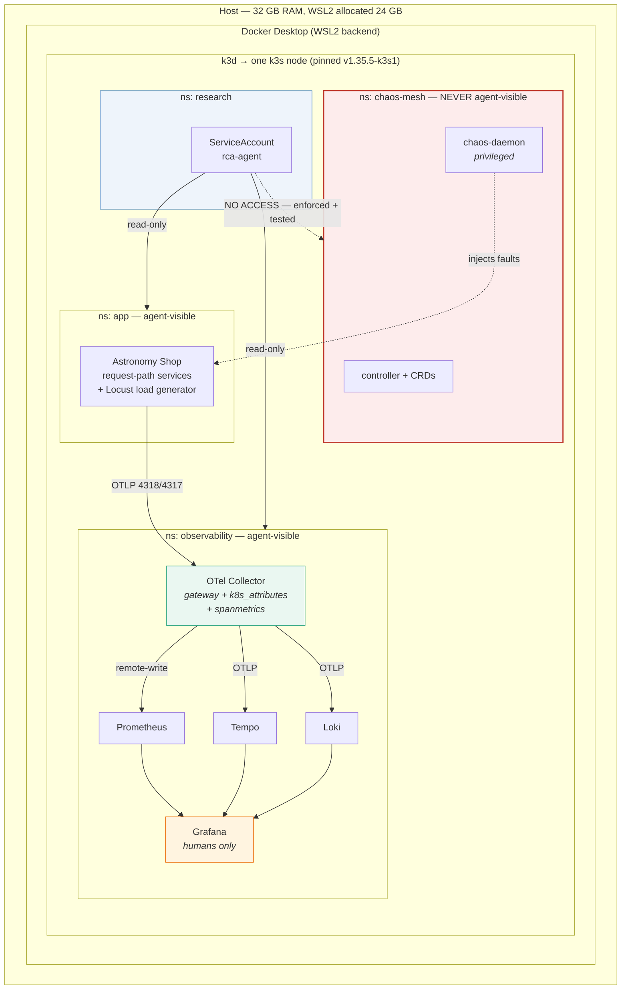
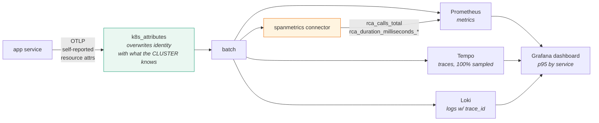
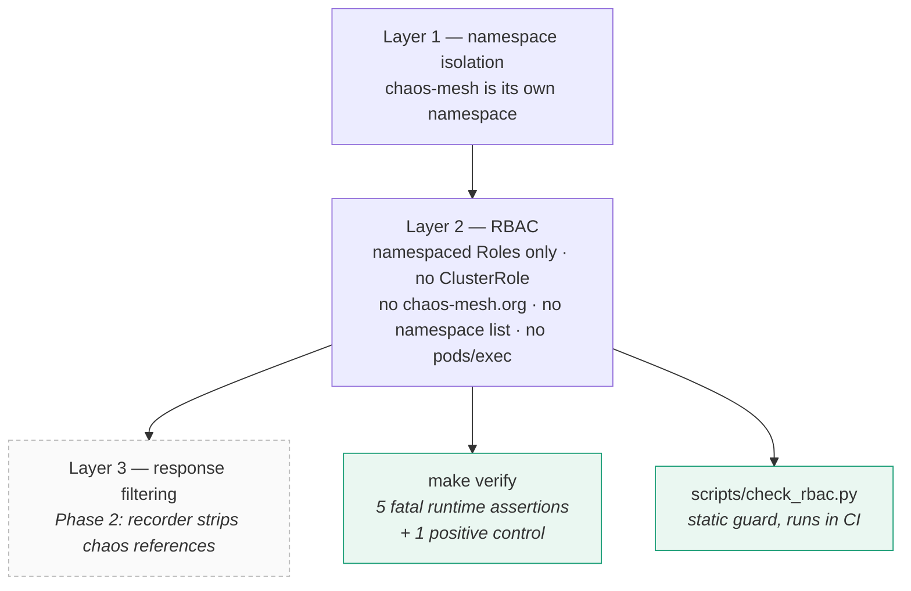

# MSc Project — Phase 1: the RCA research bench

A reproducible single-node Kubernetes bench for research into **LLM root-cause-analysis
agents**: a realistically instrumented microservice application, known faults injected
into it, all three telemetry signals collected — and the fault injector kept
**invisible** to the agent under test.

That last property is the research requirement. Everything else is engineering.

> **Status: Phase 1 complete and verified.** `make verify` passes 14 checks on a
> local k3d bench — all three signals arriving, and the trust boundary intact.

---

## Quick start

```bash
make bench TARGET=local      # cluster up → platform installed → verified
make ports                   # how to reach the UIs
```

On Windows, read [docs/06-windows-setup.md](docs/06-windows-setup.md) first — the repo
must live inside WSL2, and WSL needs more RAM than its default allocation.

---

## What Phase 1 builds



### The telemetry path

Every signal funnels through **one collector**, which is also where the Phase 7
provenance verifier will insert itself.



**Why spanmetrics:** the demo app emits only a dozen OTLP metric points, so Prometheus
alone has nothing to chart. The span stream is rich, so per-service rate/error/duration
metrics are derived from it. The namespace is pinned to `rca_` so metric names are
deterministic rather than dependent on a connector default.

**Why 100% sampling:** the Phase 7 verifier compares a callee's SERVER span against its
caller's CLIENT span. Dropping either side of a pair silently breaks the defence being
measured. Sampling is the one knob that must not be traded for memory.

### The trust boundary



An agent that can read a `NetworkChaos` object is reading the answer key, not diagnosing
an incident. Published work found **8 of 18 mitigation problems in one benchmark were
"solvable" by a pod-restart loop** because the injector was visible. Any capture run made
while `make verify` fails should be discarded.

See [docs/03-trust-boundary.md](docs/03-trust-boundary.md).

---

## Commands

| Lifecycle | |
|---|---|
| `make bench TARGET=local` | one shot: up → install → verify |
| `make local-up` / `local-stop` / `local-destroy` | cluster lifecycle |
| `make local-reset` | delete + recreate (when k3s will not resume) |
| `make wsl-memory MEM=24GB` | raise WSL's RAM allocation, then `wsl --shutdown` |

| Verify & diagnose | |
|---|---|
| `make verify` | **the gate** — liveness, trust boundary, selectors |
| `make doctor` | find unhealthy pods and say *why* (OOM vs config vs image) |
| `make diag` | what the cluster is doing right now; safe during install |
| `make telemetry` | per-signal collector counters — is each signal arriving and leaving? |

| Faults | |
|---|---|
| `make chaos-list` | available experiments and anything running |
| `make chaos-check` | assert every selector matches real pods |
| `make chaos-smoke EXP=…` | inject, measure p95 before/after, always clean up |
| `make chaos-apply` / `chaos-delete EXP=…` | manual control |

| Access | |
|---|---|
| `make ports` | print the raw `kubectl port-forward` commands |
| `make tunnel-grafana` | Grafana on :3000 (admin/admin) — `BIND=0.0.0.0` on WSL |

---

## Repository layout

```
infra/
  terraform/      AWS: VPC + one EC2 node running k3s, cost guardrails
  local/          k3d cluster definition — same k3s, zero cost
platform/
  namespaces.yaml       the trust zones
  observability/        collector + backends + provisioned dashboard
  app/                  Astronomy Shop, trimmed to the request path
  chaos/                Chaos Mesh + fault catalogue
  rbac/                 the agent identity — the research-critical file
  versions.env          PINNED chart versions
scripts/          lifecycle, verification, diagnosis
docs/             ADRs, architecture, runbook
```

---

## Reproducibility

Everything is pinned: k3s image (`v1.35.5-k3s1`) and all seven chart versions in
`platform/versions.env`. A chart or image bump between two capture runs would invalidate
comparisons between them, so upgrades are deliberate commits — `make pin-versions`,
review the diff, commit.

The app is trimmed to the services on the request path. Eight demo components are
disabled (chatbot, firepit, telemetry-docs, flagd-ui, mcp, opamp-server, accounting,
fraud-detection). **Kafka is kept deliberately**: checkout publishes to it, and removing
it would make checkout log publish errors continuously, polluting the clean baseline that
every attack measurement is compared against.

---

## What Phase 1 deliberately excludes

| Not here | Why | Lands in |
|---|---|---|
| Recorder / snapshot store | needs the agent tool surface frozen first | P2 |
| Mock tool server | depends on the recorder's format | P2 |
| eBPF observer (OBI) | second independent source for the defence | P7 |
| Provenance verifier | the contribution; needs captured data to evaluate | P7 |

---

## Next

**Phase 2 — the recorder and mock tool server.** Freezing each incident into a snapshot
so agents replay against byte-identical evidence. That is the keystone the attack and
defence phases both depend on.

The one judgement still open in Phase 1: run `make chaos-smoke`, open the Grafana
dashboard, and confirm the **victim** services top the p95 panel rather than the root
cause. If the cause is loudest, a prominence heuristic solves the scenario and a later
attack would succeed for an uninteresting reason.
