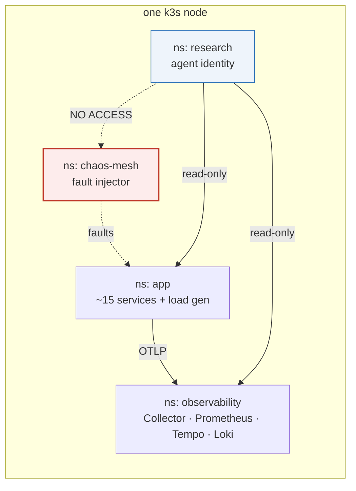

# MSc Project — Phase 1: the RCA research bench

Reproducible single-node Kubernetes bench for research into **root-cause-analysis
agents**: a realistically instrumented microservice application, known faults
injected into it, all three telemetry signals collected — and the fault injector
kept **invisible** to the agent under test.

That last property is the research requirement. The rest is engineering.

---

## Quick start

**Free, on your own machine** (needs Docker with ≥ 12 GB):

```bash
make local-up
make install TARGET=local
make verify  TARGET=local
```

**On AWS** (see [cost control](docs/04-cost-control.md) first):

```bash
cd infra/terraform && cp terraform.tfvars.example terraform.tfvars
curl -s https://checkip.amazonaws.com      # put this in allowed_cidr as x.x.x.x/32
$EDITOR terraform.tfvars && cd ../..

make tf-init && make tf-plan && make tf-apply
make kubeconfig && make install && make verify
make stop        # when you finish. always.
```

`make help` lists everything.

---

## What gets built



| Layer | What | Where |
|---|---|---|
| Infrastructure | one EC2 node running k3s, **or** k3d locally | `infra/` |
| Observability | OTel Collector → Prometheus, Tempo, Loki (+ Grafana for humans) | `platform/observability/` |
| Application | OpenTelemetry Astronomy Shop (~15 services, all three signals native) | `platform/app/` |
| Faults | Chaos Mesh + a catalogue where the loudest symptom is a **victim**, not the cause | `platform/chaos/` |
| Trust boundary | agent ServiceAccount with no path to the fault injector | `platform/rbac/` |

Both targets run **the same k3s**, so `platform/` applies unchanged to either.

---

## The one thing to understand

```bash
make verify
```

runs two classes of check: **liveness** (is the bench working?) and **validity**
(is the trust boundary intact?). The validity checks are fatal.

An agent that can read a `NetworkChaos` object is reading the answer key, not
diagnosing an incident. Published work found that **8 of 18 mitigation problems in
one benchmark could be "solved" by a pod-restart loop** that never diagnoses
anything, because the injector was visible. Any capture run performed while
`make verify` fails should be **discarded**.

See [docs/03-trust-boundary.md](docs/03-trust-boundary.md).

---

## Documentation

| Doc | Read it when |
|---|---|
| [Platform choice](docs/01-platform-choice.md) | "AWS free tier, GCP, or minikube?" — answered, with costs |
| [Architecture](docs/02-architecture.md) | understanding the shape of the bench |
| [Trust boundary](docs/03-trust-boundary.md) | **before touching `platform/rbac/`** |
| [Cost control](docs/04-cost-control.md) | before leaving anything running |
| [Runbook](docs/05-runbook.md) | day-to-day operation and troubleshooting |

---

## Repository layout

```
infra/
  terraform/     AWS: VPC, one EC2 node, k3s via cloud-init, cost guardrails
  local/         k3d cluster definition (same k3s, zero cost)
platform/
  namespaces.yaml      the trust zones
  observability/       collector + backends (Helm values)
  app/                 Astronomy Shop (Helm values)
  chaos/               Chaos Mesh + fault catalogue
  rbac/                agent identity — the research-critical file
  versions.env         chart version pins (run `make pin-versions` after first install)
scripts/         bench lifecycle, kubeconfig, tunnels, install, verify
docs/            ADRs, architecture, runbook
```

---

## Status and caveats

- **Terraform has not been applied.** It was authored without cloud credentials or
  a Terraform binary available. CI runs `fmt`, `validate` and `tflint` on every
  push; read the first `terraform plan` carefully regardless.
- **Chart versions are unpinned** until you run `make pin-versions` after a
  successful install. Pin and commit before capturing any incident — a chart bump
  between two capture runs invalidates comparisons between them.
- **Helm values keys drift between chart major versions.** `make show-app-values`
  prints the chart's own defaults so you can diff the keys used here against them.
- Prices quoted in the docs are approximate and change. Verify before relying on them.

## Next phase

Phase 2 adds the **recorder** and **mock tool server** — freezing each incident into
a snapshot so agents can be replayed against byte-identical evidence. That is the
keystone the attack and defence phases both depend on.
