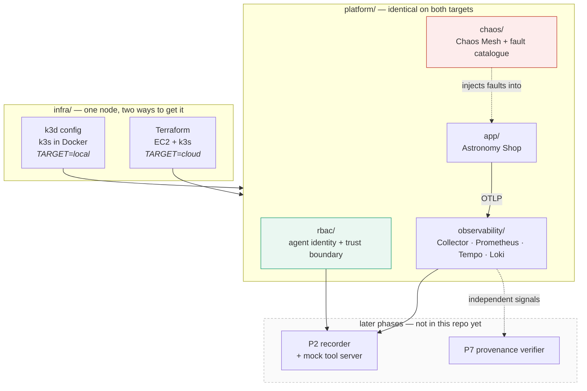
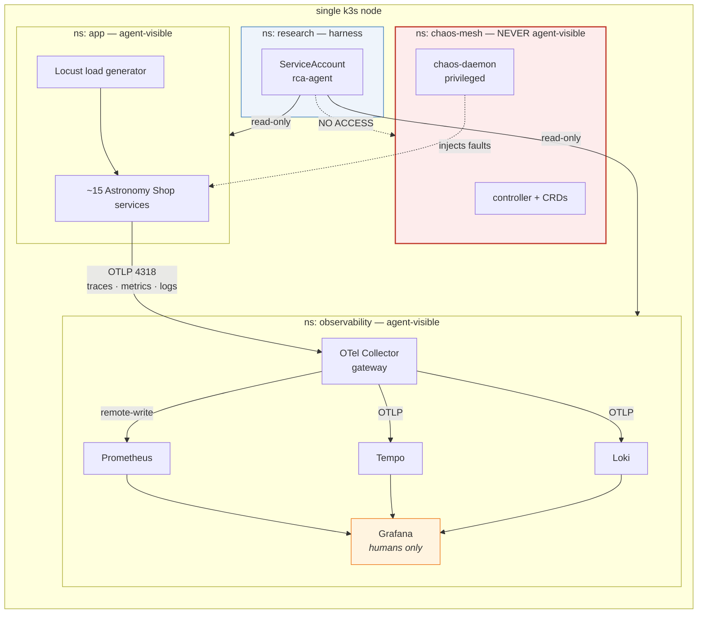
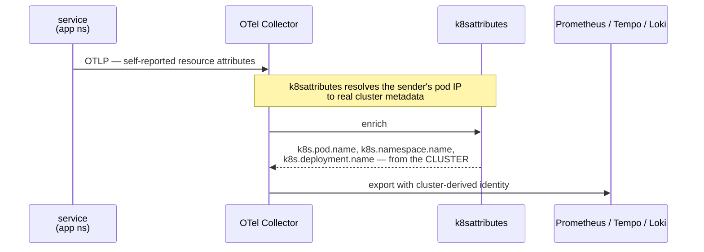
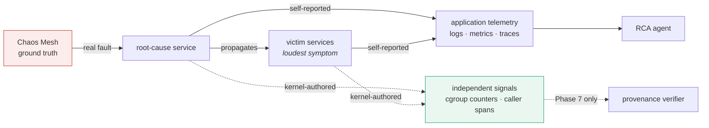

# Architecture

Phase 1 delivers the **bench**: a reproducible cluster that produces honest
telemetry from known faults, with the fault injector hidden from the agent under
test. Later phases (capture, forgery, defence) build on it without changing it.

## Layers



## Runtime topology

Everything lives on one node. Namespaces carry the trust boundary.



## Telemetry path, and why the Collector is a single gateway



Everything funnels through one Collector on purpose. It is:

1. the **single place to attribute telemetry** — `k8sattributes` overwrites what a
   workload claims about itself with what the cluster knows, which is a weak form
   of the authorship check Phase 7 generalises;
2. the **natural insertion point** for the Phase 7 provenance verifier, which
   becomes a processor in this pipeline rather than a change to every service;
3. the **single tap** the Phase 2 recorder reads from.

## Fault injection and the two signal classes



The distinction set up here is what the whole project turns on:

- **Application telemetry is self-reported.** A service says how it is doing. In
  every backend, "which service emitted this" is just a label set by the sender,
  authenticated by nothing.
- **Independent signals are authored elsewhere** — the caller's own span, the
  kernel's cgroup counters. A workload cannot write them.

Phase 1 makes sure both classes are present and captured. Phase 7 uses the second
to check the first.

## Why the fault catalogue is shaped the way it is

Every experiment is designed so the **loudest symptom is a victim, not the cause**.
The fault-propagation-aware benchmark (FSE 2026) found that on four widely used
public RCA benchmarks the root cause is identifiable by simple correlation, because
the root-cause service's own symptom is the most prominent. On a dataset like that,
any attack that plants a prominent anomaly succeeds for an uninteresting reason.

See `platform/chaos/experiments/README.md` for the per-experiment rationale.

## Derived metrics, and why

The demo app emits only about a dozen OTLP metric points, so Prometheus alone
has nothing to chart. The span stream is rich. The collector therefore runs the
**spanmetrics connector**, deriving per-service rate, error and duration series
from spans:

```
rca_calls_total
rca_duration_milliseconds_{bucket,sum,count}
```

The namespace is pinned to `rca_` so the names are deterministic rather than
dependent on a connector default that has changed across versions. The
provisioned Grafana dashboard queries exactly those names, and the datasource
UIDs are pinned too — a randomly assigned UID makes every panel read
"datasource not found", which looks identical to having no data.

## The tooling, and what each tool refuses to do

Phase 1 produced more diagnostic tooling than planned, because several bugs
presented as healthy systems. Each of these exists to make one specific
ambiguity impossible:

| Command | Makes impossible |
|---|---|
| `make verify` | capturing while the trust boundary is broken |
| `make doctor` | confusing OOMKilled with a rejected config (both show CrashLoopBackOff) |
| `make telemetry` | confusing "the app emits nothing" with "the exporter cannot deliver" |
| `make chaos-check` | a selector that matches zero pods passing as a working experiment |
| `make chaos-smoke` | an injected fault left running after a crash (EXIT trap) |
| preflight in `make install` | a schema error discovered after half the stack has upgraded |

A recurring theme is worth recording for the thesis: three separate times, a
**failed read was reported as a negative result** — a mis-typed Loki marker, a
wrong Tempo port, and an unreachable API server that made `doctor` announce
"no problems found". That is precisely the confusion the project's attack
exploits, encountered accidentally in its own tooling.

## What Phase 1 deliberately does not include

| Not here | Why | Where it lands |
|---|---|---|
| Recorder / snapshot store | needs the tool surface frozen first | P2 |
| Mock tool server | depends on the recorder's format | P2 |
| eBPF observer (OBI) | second independent source; verify OBI 1.0 shipped | P7 |
| Provenance verifier | the contribution; needs captured data to evaluate | P7 |
| Agent scaffolds under test | HolmesGPT et al. attach to the tool API, not the cluster | P1→P5 |
