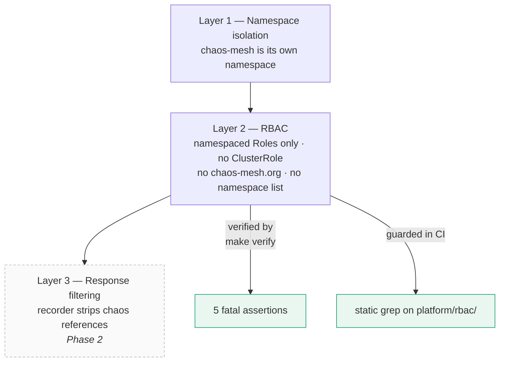

# The trust boundary

> This is the most important document in Phase 1. Everything else is plumbing.

## The failure it prevents

The RCA agent under test must diagnose an incident from **symptoms**. If it can
read the fault injector's own objects, it is reading the answer key — and every
measurement taken afterwards is meaningless, while looking entirely healthy.

This is not hypothetical. The SREGym paper reports that in AIOpsLab and ITBench the
fault injectors "run as identifiable pods in the same environment the agent
inspects", and cites a finding that **8 of 18 ITBench mitigation problems (44%) can
be 'solved' by a generic pod-restart loop** that never diagnoses anything.

An attack evaluated against an agent that can cheat measures the cheat, not the attack.

## Three layers of defence

### Layer 1 — namespace isolation

`chaos-mesh` is a separate namespace labelled `bench.msc/agent-visible: "false"`.
Necessary, nowhere near sufficient on its own.

### Layer 2 — RBAC (this phase)

`platform/rbac/agent-serviceaccount.yaml` grants the `rca-agent` ServiceAccount:

- **namespaced `Role`s only**, in `app` and `observability`
- read-only verbs, plus `pods/log` — the primary evidence channel
- **no `ClusterRole`, ever.** A read-only ClusterRole would still let the agent
  list every namespace and discover `chaos-mesh`
- **no `chaos-mesh.org` API group**, anywhere. Even a single `get` leaks ground truth
- **no `namespaces` list** at cluster scope
- **no `pods/exec`** — with exec the agent could observe injected `tc` rules and
  stress processes inside the target pod, a side channel to the answer

### Layer 3 — response filtering (Phase 2)

RBAC still is not enough, because **chaos side effects leak into the target pod**:

| Leak | Where it shows up |
|---|---|
| `tc` / `iptables` rules | inside the target's network namespace |
| stress processes | inside the target's cgroup |
| Kubernetes events | may name the experiment |
| pod annotations | may reference the chaos controller |

In the replay architecture this becomes easy: the Phase 2 recorder owns every tool
response, so it can strip chaos references before an agent ever sees them. That is
one more reason the capture layer pays for itself — and why `pods/exec` stays
ungranted until the recorder can filter it.

## How it is enforced

Two independent mechanisms, because this property is too important to check once.

**1. Runtime — `make verify`.** Five assertions, all fatal:

| # | Assertion |
|---|---|
| B1 | agent cannot list `NetworkChaos` cluster-wide, nor `get PodChaos` in `chaos-mesh` |
| B2 | agent cannot list namespaces |
| B3 | agent cannot list pods in `chaos-mesh` |
| B4 | no `ClusterRoleBinding` references `rca-agent` |
| B5 | **positive control** — agent *can* read pod logs in `app` |

B5 matters as much as the rest: a boundary so tight the agent has no evidence to
reason over would also invalidate the experiment, in the opposite direction.

**2. Review time — CI.** The `rbac-guard` job statically greps `platform/rbac/` for
`ClusterRole`, `chaos-mesh.org` and `namespace: chaos-mesh`, and fails the build on
any hit. It needs no cluster, so a bad commit is caught at review rather than
discovered mid-capture.

## If you need to change this

Don't, casually. If a later phase genuinely needs broader access:

1. Write down which specific capability is needed and why.
2. Add it as a **namespaced** rule in `app` or `observability` — never cluster-scoped.
3. If it could expose chaos state (`pods/exec`, events, annotations), add a
   corresponding **filter in the recorder** in the same change.
4. Re-run `make verify`, and add an assertion covering the new surface.
5. Note it in the thesis's threats-to-validity section. A reviewer will ask what the
   agent could see; the honest answer should be written down, not reconstructed.

Any capture run performed while `make verify` fails should be **discarded**, not
patched up afterwards.
