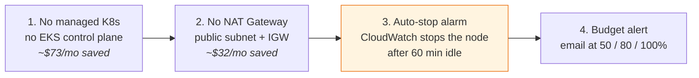

# Cost control

The realistic way a credit-funded research account dies is not a wrong instance
type. It is **leaving the bench running over a weekend**.

## The four guardrails



1. **No managed Kubernetes.** See [ADR-001](01-platform-choice.md) — it is also the
   wrong technical choice here, so this is not a trade-off.
2. **No NAT Gateway.** The node sits in a public subnet with a security group
   locked to `allowed_cidr` and reaches the internet through the (free) Internet
   Gateway. A NAT Gateway is ~$32/month plus data processing for no benefit on a
   single-node bench.
3. **Auto-stop.** A CloudWatch alarm stops the instance after
   `auto_stop_idle_minutes` below `auto_stop_cpu_threshold` CPU. This is the safety
   net for the failure mode above. Note it will also stop the node during a long
   *idle* phase of a capture run — if that bites, raise the threshold rather than
   disabling the alarm.
4. **Budget alerts.** Set `budget_alert_email` to arm them. The first two AWS
   Budgets are free.

## What bills when

| State | Compute | Storage | Public IP |
|---|---|---|---|
| Running | **yes** | yes | yes |
| **Stopped** | **no** | yes (~$8/mo at 100 GB) | small |
| Destroyed | no | no | no |

`make stop` is the single highest-leverage habit on this project. The root volume
is the floor, and it is the price of being able to restart in 60 seconds instead of
rebuilding the whole bench.

## The architectural saving

The capture-once-replay-many design means **the cluster is only needed while
capturing incidents**. Phase 5 runs thousands of agent trials against frozen
snapshots with no cluster at all.

```mermaid
gantt
    title Where the cloud cost actually falls
    dateFormat X
    axisFormat %s
    section Cluster needed
    P0 bring-up          :0, 2
    P1 harness           :2, 3
    P2 capture incidents :5, 3
    P3 live validation   :12, 1
    section No cluster needed
    P3 forgery dev     :8, 4
    P4 realism         :12, 3
    P5 attack grid     :15, 5
    P6 baselines       :20, 3
    P7 verifier        :22, 6
```



Cloud spend is bounded by the capture window — days — regardless of how long the
analysis runs. Budget accordingly: a burst of `t3.2xlarge` during capture costs far
less than a quarter of `t3.xlarge` left idle.

## Spot

`use_spot = true` is roughly 60–70% cheaper and configured with
`instance_interruption_behavior = "stop"`, so the root volume survives a reclaim.

**Keep it off for Phase 2 capture runs.** A reclamation mid-incident produces a
*partially* captured snapshot, which is worse than an obvious failure because it
may not be noticed until analysis. Spot is fine for development and for the Phase 5
replay grid, which has no cluster anyway.

## Weekly hygiene

```bash
make status          # is it running right now?
make stop            # end of every session

# monthly: what has it actually cost?
aws ce get-cost-and-usage \
  --time-period Start=$(date -u -d '30 days ago' +%F),End=$(date -u +%F) \
  --granularity MONTHLY --metrics UnblendedCost \
  --group-by Type=DIMENSION,Key=SERVICE
```

When a phase finishes and the next one needs no cluster, run `make tf-destroy`
rather than leaving a stopped instance and its volume billing for weeks.
