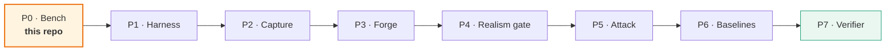

# Documentation

| Doc | Read it when |
|---|---|
| [01 — Platform choice](01-platform-choice.md) | deciding where to run the bench; answers "AWS free tier, GCP, or minikube?" |
| [02 — Architecture](02-architecture.md) | understanding what Phase 1 builds and why it is shaped that way |
| [03 — Trust boundary](03-trust-boundary.md) | **before changing anything under `platform/rbac/`** |
| [04 — Cost control](04-cost-control.md) | before leaving the bench running |
| [05 — Runbook](05-runbook.md) | day-to-day operation |

## Phase 1 in one paragraph

Build a reproducible single-node Kubernetes bench that runs a realistically
instrumented microservice application, injects known faults into it, and collects
all three telemetry signals — **while keeping the fault injector invisible to the
RCA agent under test**. That last clause is the research requirement; the rest is
engineering. See [03](03-trust-boundary.md).

## Where this sits

Full phase definitions are in the implementation roadmap (*Build Order*).
